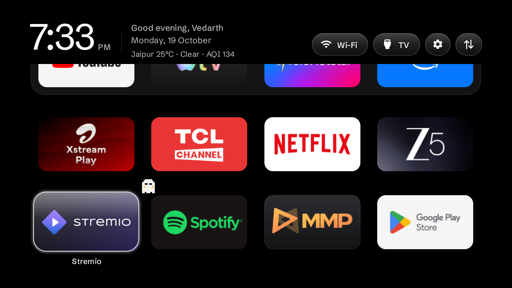
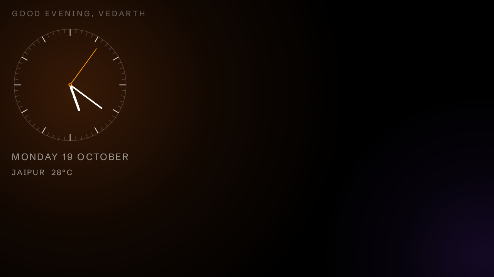
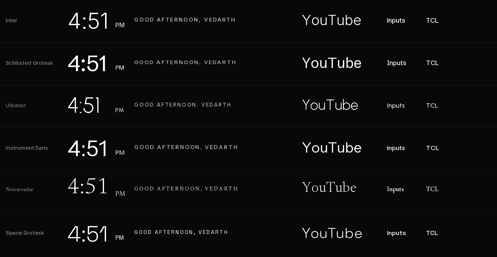

# Android_TV_Debloater

Debloating a **TCL Google TV (G13, MediaTek mt5867, Android 14)** over Wi-Fi ADB, and replacing its
ad-filled stock home screen with a clean, Apple-TV-style launcher that I built from
[tv-vibehack](https://github.com/Gathin23/tv-vibehack).

Nothing was flashed or rooted. System apps are only turned off per user (never deleted); the only
removals are apps this project installed itself (TV Bro) and one uninstall for user 0 (YouTube Music),
both reversible.

## What is this, exactly?

| | |
|---|---|
| The app | **TV Home** — a standalone launcher (`com.gathin.tvhome`), plain Java, ~250 KB. It is not a patch, a ROM or a modified Google TV. |
| This repo | **TV Home Kit** — the launcher source, the reversible debloat profile for this TCL, and the scripts to build, install, restore and port it. |
| On the TV | A new Home app plus a set of `pm disable-user` entries. No system APK was deleted. |

"Patch" would be wrong — nothing is modified in place. "Software" is true but too vague. The short
name is **TV Home**; the whole kit is **TV Home Kit**.

## Docs

| | |
|---|---|
| [tv-setup/README.md](tv-setup/README.md) | what changed on **this** TV, and how to undo or customise it |
| [docs/ARCHITECTURE.md](docs/ARCHITECTURE.md) | how the launcher works, every config key, and recipes for adding features |
| [docs/PORTING.md](docs/PORTING.md) | install it on **another** Android TV — manual steps, agent playbook, per-brand notes |

| Before — stock Google TV, ad row on top | After — the new home screen |
|---|---|
|  |  |

## Status

Done and verified on the TV, screenshot by screenshot:

| | |
|---|---|
| Debloat | 23 packages + the stock launcher disabled for user 0 (24 off in total); YouTube Music also removed for user 0 |
| Launcher | `com.gathin.tvhome` installed and **owns Home** — ~250 KB, plain Java, no libraries |
| Navigation | one-row Up/Down, Up → top pills, pill-row ends hold, last tile remembered |
| Grid order | Xstream Play, TCL Channel, Netflix, ZEE5, Stremio, Spotify, then the rest — editable, see below |
| Inputs | the pill reads **TV** and sits after Wi-Fi: HDMI 1, HDMI 2, Composite (AV), Live TV |
| TCL Channel | a normal tile; the MediaTek tuner only in the Inputs menu |
| Stremio | **1.10.4**, official Android TV APK, sideloaded (`com.stremio.one`); TV Bro removed |
| Wi-Fi pill | shows the connected network, `204_5G` here |
| Greeting | `Good evening, Vedarth`, by time of day, above the date; only the big 68 sp time sits on the left |
| Weather | Jaipur, °C — plain-language condition and US AQI from Open-Meteo, no key, refreshed every 10 minutes |
| Mascot | a 26 dp pixel companion drawn on Canvas; hops to the focused tile. No bitmap, no idle animation |
| Screensaver | a centred 360 dp analog dial with a ticking second hand, greeting, date and weather |
| Photo slideshow | built in but **off** — it needs one 720p bitmap (~1.8 MB) while the dream runs |
| Sideloading | `tv-setup/install-apk.ps1` — local APK or GitHub URL |

## The screens

| Home | Apps |
|---|---|
|  |  |

| Screensaver | Font shortlist |
|---|---|
|  |  |

## Layout

```
Android_TV_Debloater/
├── tv-setup/          my own docs and scripts for THIS TV
│   ├── README.md          what changed, how to undo it, how to customise
│   ├── restore-tv.ps1     put the TV back the way it was
│   ├── rebuild-launcher.ps1   rebuild + reinstall the launcher
│   ├── install-any-tv.ps1     install on any Android TV (stock adb)
│   └── set-clock-screensaver.ps1
├── docs/              architecture, porting, and the README screenshots
├── tv-vibehack/       the launcher source and ADB tools (git subtree of upstream)
└── screenshots/       verification captures (not tracked)
```

## Quick start

```powershell
# put the TV back exactly as it was
powershell -ExecutionPolicy Bypass -File tv-setup\restore-tv.ps1

# after editing tv-vibehack\launcher\app\src\main\res\values\config.xml
powershell -ExecutionPolicy Bypass -File tv-setup\rebuild-launcher.ps1
```

Everything else — re-enabling a single app, changing the dock order, changing the background or
wallpaper, troubleshooting — is in **[tv-setup/README.md](tv-setup/README.md)**.

## Customising without a rebuild

Upstream `tv-vibehack` supports a JSON theme overlay: drop a `config.json` (and optionally a
`wallpaper.jpg`) on the TV with `tv-vibehack/tools/theme.ps1` and the launcher picks it up at the
next Home start — no APK rebuild. See [tv-vibehack/themes/README.md](tv-vibehack/themes/README.md).

## Keeping up with upstream

`tv-vibehack/` is a git subtree of upstream, so its full history is here and updates can be pulled
without losing the TCL-specific commits:

```powershell
git remote add upstream https://github.com/Gathin23/tv-vibehack.git   # once
git fetch upstream
git subtree pull --prefix=tv-vibehack upstream main
```

## Notes

- This folder lives in OneDrive. Pause syncing while ADB or Gradle is writing if it gets in the way.
- `tv-vibehack/tools/venv`, `backup/`, build outputs and `tools/adbkey` are untracked on purpose —
  the ADB key is private and the backup contains this TV's serials.
- The launcher's own [MIT licence](tv-vibehack/LICENSE) applies to `tv-vibehack/`.
