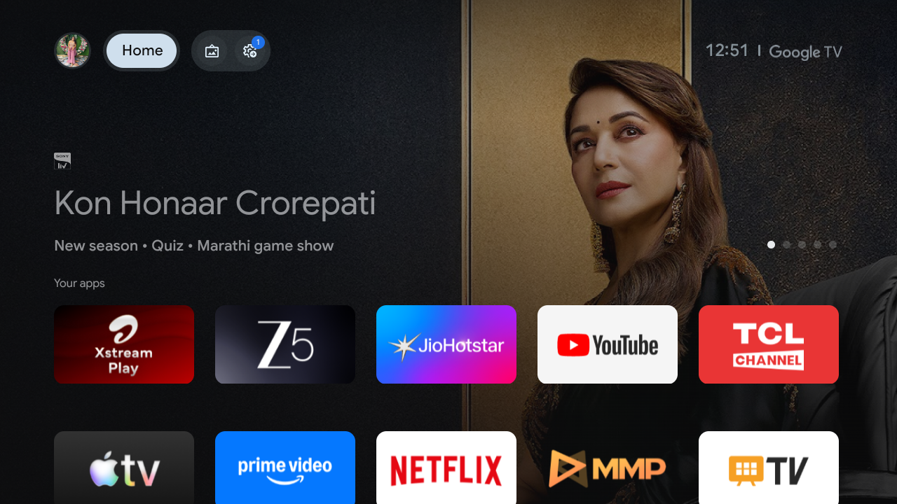
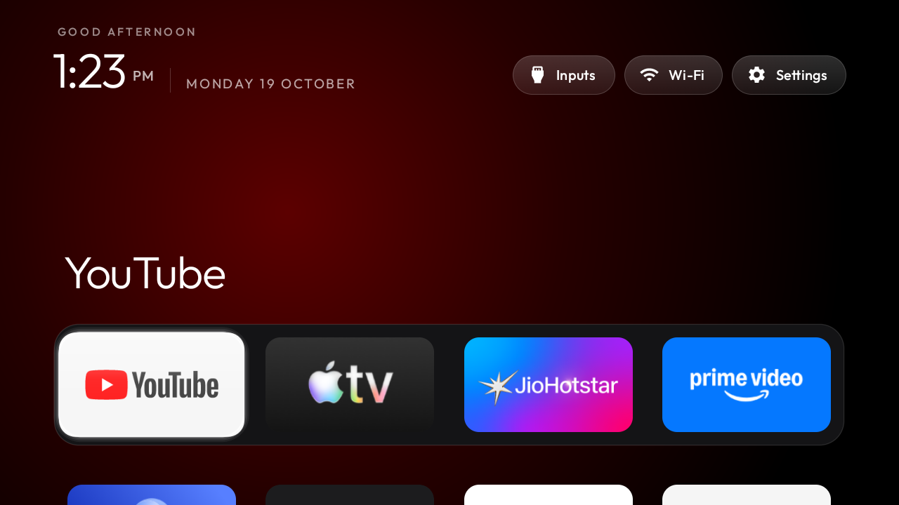

# Android_TV_Debloater

Debloating a **TCL Google TV (G13, MediaTek mt5867, Android 14)** over Wi-Fi ADB, and replacing its
ad-filled stock home screen with a clean, Apple-TV-style launcher that I built from
[tv-vibehack](https://github.com/Gathin23/tv-vibehack).

Nothing was flashed, rooted or uninstalled: every change is reversible with one script.

| Before — stock Google TV, ad row on top | After — the new home screen |
|---|---|
|  |  |

## Status

Done and verified on the TV, screenshot by screenshot:

| | |
|---|---|
| Debloat | 24 packages disabled for user 0 + the stock launcher |
| Launcher | `com.gathin.tvhome` installed and **owns Home** |
| Navigation | one-row Up/Down, Up → top pills, pill-row ends hold, last tile remembered |
| Inputs | HDMI 1, HDMI 2, Composite (AV), Live TV |
| Live TV | also a normal tile in the grid |
| Wi-Fi pill | shows `204_5G` |
| Greeting | `GOOD AFTERNOON, VEDARTH`, by time of day |
| Screensaver | the launcher's Clock: greeting, time-of-day colour, 3×3 drift (verified on the TV) |
| Sideloading | `tv-setup/install-apk.ps1` — local APK or GitHub URL |

## Layout

```
Android_TV_Debloater/
├── tv-setup/          my own docs and scripts for THIS TV
│   ├── README.md          what changed, how to undo it, how to customise
│   ├── restore-tv.ps1     put the TV back the way it was
│   ├── rebuild-launcher.ps1   rebuild + reinstall the launcher
│   └── set-clock-screensaver.ps1
├── tv-vibehack/       the launcher source and ADB tools (git subtree of upstream)
└── screenshots/       verification captures (not tracked)
```

## Quick start

```powershell
# put the TV back exactly as it was
powershell -ExecutionPolicy Bypass -File tv-setup\restore-tv.ps1

# after editing tv-vibehack\launcher\app\src\main\res\values\config.xml
powershell -ExecutionPolicy Bypass -File tv-setup\rebuild-launcher.ps1
```

Everything else — re-enabling a single app, changing the dock order, changing the background or
wallpaper, troubleshooting — is in **[tv-setup/README.md](tv-setup/README.md)**.

## Customising without a rebuild

Upstream `tv-vibehack` supports a JSON theme overlay: drop a `config.json` (and optionally a
`wallpaper.jpg`) on the TV with `tv-vibehack/tools/theme.ps1` and the launcher picks it up at the
next Home start — no APK rebuild. See [tv-vibehack/themes/README.md](tv-vibehack/themes/README.md).

## Keeping up with upstream

`tv-vibehack/` is a git subtree of upstream, so its full history is here and updates can be pulled
without losing the TCL-specific commits:

```powershell
git remote add upstream https://github.com/Gathin23/tv-vibehack.git   # once
git fetch upstream
git subtree pull --prefix=tv-vibehack upstream main
```

## Notes

- This folder lives in OneDrive. Pause syncing while ADB or Gradle is writing if it gets in the way.
- `tv-vibehack/tools/venv`, `backup/`, build outputs and `tools/adbkey` are untracked on purpose —
  the ADB key is private and the backup contains this TV's serials.
- The launcher's own [MIT licence](tv-vibehack/LICENSE) applies to `tv-vibehack/`.
