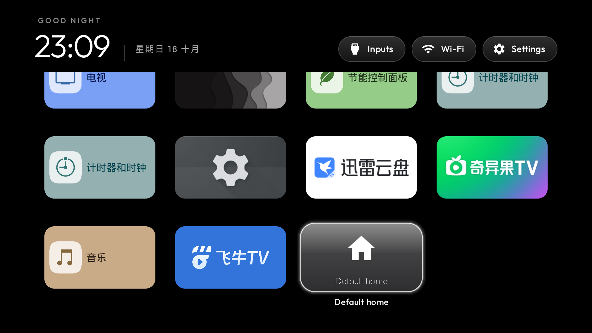

# Default-home shortcut

The shortcut opens the platform `Settings.ACTION_HOME_SETTINGS` page. The user makes the
choice in Android settings, then presses Home. It does not grant itself a role, issue shell
commands, start a background service, or enable a disabled launcher. Firmware without an
accessible HOME-settings activity gets the existing “Not available on this TV” message.

`show_home_settings_shortcut` in `config.xml` controls whether the tile is appended to the grid.
There are no vendor package names in Java. The small internal activity has no intent filters,
is not exported, and finishes immediately after handing off to settings. Its separate task
affinity prevents the launcher's single-task configuration from swallowing the handoff.

## Real-TV validation

Tested on Sony K-85XR70 (China), Android 14/API 34, firmware 114.602.170.1, on 18 October 2026.
The stock launcher stayed enabled. See compatibility report #29 for the device's scope and limits.

The exact contribution code was compiled using JDK 17, Android SDK 34/build-tools 34.0.0 and
the existing AndroidX dependencies, via local SDK compilation rather than the Gradle wrapper.
APK signature verification passed. No launcher dependencies were added.

For this test, the manifest used a separate application ID and omitted the HOME intent filter;
the Java package and feature code were unchanged. The installed working launcher and its saved
order remained separate. No location permission was granted to the test package.

Verified through injected remote keys and UI hierarchy/screenshot checks:

- Navigate down to the appended Default home tile.
- Right and Down at that final tile keep focus on it.
- Center opens the system chooser containing the stock home, the working custom home and Emotn UI.
  The isolated test package is absent from HOME candidates.
- Back cancels without changing the default; the launcher is usable again.
- Up reaches the top bar; the top-bar end boundaries remain usable.
- Home returns to the working launcher; the selected default remains `com.gathin.tvhome`.

The earlier Sony-specific version's actual switch-to-stock and switch-back flow was verified
in the same session. This isolated contribution test deliberately did not repeat a role switch.
Unavailable-settings handling, other vendors, reboot behavior and low-memory devices were not
verified on hardware. This is not a multi-day compatibility claim.

