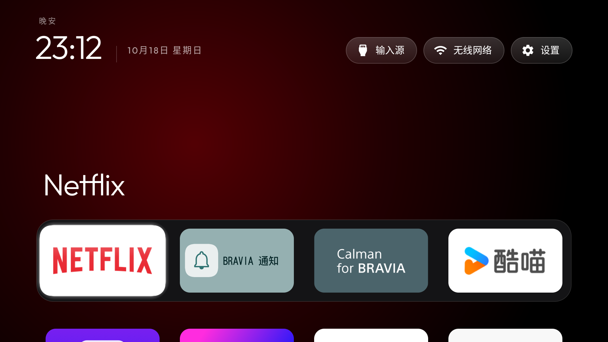

# Simplified Chinese localisation

`values-zh-rCN/strings.xml` translates all 20 strings in the current English default resource.
It preserves the `%1$s` error-message placeholder and uses `M月d日 EEEE` for the date.
No launcher configuration, font, default-language resource or application behavior changes.

Tested on Sony K-85XR70 (China), Android 14/API 34, firmware 114.602.170.1, on 18 October 2026.
The isolated test APK had a different application ID and no HOME intent filter. The existing
working launcher and selected HOME were preserved. Official SDK compilation, signature
verification, resource-name/format-placeholder parity and `git diff --check` passed.
Gradle/lint were not verified in this environment.

Real-TV checks confirmed the Chinese greeting, readable Chinese date and three top-bar labels,
plus translated disconnected statuses in the input menu. No HDMI input was switched.
The test app's own language was then changed to `en-US`: greeting, date and top-bar labels
returned to English. The TV's global language was not changed. Other greetings, error toasts
and the screensaver label were resource-checked but not all triggered on hardware.

